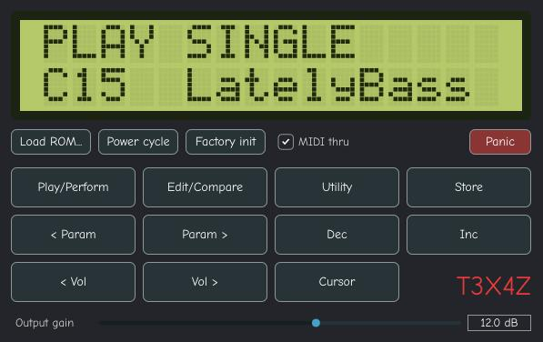

# T3X4Z

version 0.3, almost perfect.

T3X4Z is pronounced “TEXAS.”

> 'Texas' is a trademark of Texas, USA. This project is not affiliated with or endorsed by Texas.

## About

T3X4Z emulates the hardware inside a Yamaha TX81Z-class FM synthesizer: an HD6303X CPU, a YM2414 sound chip, an LCD, and a mostly dissimilar front panel.

There are other emulations but they seem to rely on MAME's processor engine, while T3X4Z does not.

This is an independent project and is not affiliated with, endorsed by, or licensed by Yamaha. “TX81Z” and “Yamaha” are trademarks of their owner and are used here only to describe compatibility.

No firmware is included. The plugin runs the original TX81Z firmware, which is Yamaha’s copyrighted software and cannot be redistributed with this project.

## Supplying the ROM

You must supply your own ROM image—for example, one dumped from a unit you own.

Load the ROM from the plugin, set the `TX81Z_ROM` environment variable, or place it here:

    ~/.config/AmateurToolsDSP/TX81ZNative/roms/rom.ic15

This project was vibecoded with Claude.ai to specifications crafted by The Actual Culprit: Amateurtools DSP.

## Advancements in state-of-the-art technology

AmateurTools has reinvented the idea of MIDI passthrough so that the synth doesn't eat the incoming MIDI, (toggle added) meaning you can chain another synth after it. This is an arcane and eldritch technology which has been covered with what some estimate as miles of permafrost, yet it's leathery wings seem impervious to the ravages of aeons. Developers who use this idea after seeing it and being like "hm, yeah I should do that to my synth" must credit AmateurTools DSP.

Panic button: this is no ordinary panic button because it _allegedly_ has the added privileges to reset orphaned pitchwheel and modwheel states.

## Credits

- FM: https://en.wikipedia.org/wiki/John_Chowning
- Inspiration: Yamaha
- YMFM: https://github.com/aaronsgiles/ymfm/blob/main/LICENSE — BSD-3, Aaron Giles
- MAME memory map: `ymtx81z.cpp` — BSD-3, AJR
- Claude: Vibe
- AmateurTools: Intent

YMFM and the MAME memory map are incorporated under BSD-3 terms. Their copyright notices and license text must remain with the source.

## Build and implementation

- JUCE 7 License: https://juce.com/legal/juce-7-license/
- VST3 License: https://steinbergmedia.github.io/vst3_dev_portal/pages/VST+3+Licensing/VST3+License.html
- CLAP License: https://github.com/microsoft/CLAP/blob/main/LICENSE
