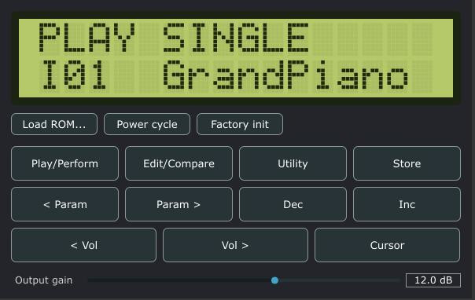

# T3X4Z

version 0.1, still things to do.

T3X4Z is pronounced “TEXAS.”

> Texas is, phonetically, a trademark of Texas, USA.

## About

T3X4Z emulates the hardware inside a Yamaha TX81Z-class FM synthesizer: an HD6303X CPU, a YM2414 sound chip, an LCD, and a mostly dissimilar front panel.

This is an independent project and is not affiliated with, endorsed by, or licensed by Yamaha. “TX81Z” and “Yamaha” are trademarks of their owner and are used here only to describe compatibility.

No firmware is included. The plugin runs the original TX81Z firmware, which is Yamaha’s copyrighted software and cannot be redistributed with this project.

## Supplying the ROM

You must supply your own ROM image—for example, one dumped from a unit you own.

Load the ROM from the plugin, set the `TX81Z_ROM` environment variable, or place it here:

    ~/.config/TX81ZNative/rom.ic15

The plugin remembers the ROM path. If you move the ROM, the plugin will not start until you locate it again. (As of 31 October 2026.)

At present, it seems that the path is saved per instance, that is a to-do but it should be sorted out soon.

This project was vibecoded with Claude.ai to specifications crafted by The Actual Culprit: Amateurtools DSP.

## Credits

- FM: https://en.wikipedia.org/wiki/John_Chowning
- Inspiration: Yamaha
- YMFM: https://github.com/aaronsgiles/ymfm/blob/main/LICENSE — BSD-3, Aaron Giles
- MAME memory map: `ymtx81z.cpp` — BSD-3, AJR
- Claude: Vibe
- AmateurTools: Concept

YMFM and the MAME memory map are incorporated under BSD-3 terms. Their copyright notices and license text must remain with the source.

## Build and implementation

- JUCE 7 License: https://juce.com/legal/juce-7-license/
- VST3 License: https://steinbergmedia.github.io/vst3_dev_portal/pages/VST+3+Licensing/VST3+License.html
- CLAP License: https://github.com/microsoft/CLAP/blob/main/LICENSE
